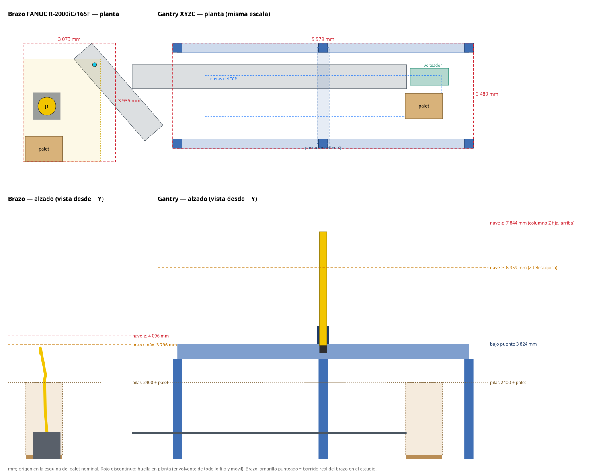

# Brazo FANUC R-2000iC/165F frente a gantry XYZC · alcance, colisiones y layout

Mismas comprobaciones por caja en el orden real del algoritmo (`palca.robot.cell_study.evaluate_run`): entrada por el pasillo, bajada desplazada 20 mm al lateral libre, deslizamiento, límites y colisiones con nube de puntos contra las cajas ya colocadas, y caja transportada. Generado con `scripts/gantry_reach_study.py` y `scripts/robot_compare_report.py`.

## Qué configuración de palet

- **Brazo**: `h6_sin_gate` (preset `arm6_4orient`, accesibilidad 400 mm), 10 seeds de referencia, KPI medio **77.06 %**.
- **Gantry**: `h6_sin_gate_gantry` = mismas técnicas H1+H3+H5+H6 sin gate pero con el preset `gantry_4orient` (`accessibility_delta_mm = 0`, `configs/sweeps/h6_sin_gate_gantry.yaml`). Es la configuración que tendría un pórtico, que baja en vertical y no necesita la restricción de 400 mm (con delta 0 la deuda de accesibilidad H1 queda inactiva por construcción). KPI medio **79.29 %** en las mismas 10 seeds (exportación verificada bit-idéntica en la 50021).
- Como control, el gantry también se evalúa sobre los palets de `h6_sin_gate` (los del brazo).

## Resumen

| | Brazo R-2000iC/165F | Gantry XYZC |
|---|---|---|
| Colocaciones viables | **1787 / 1860 (96.1 %)** en `h6_sin_gate` | **1860 / 1860 (100.0 %)** en `h6_sin_gate_gantry`; 1860 / 1860 (100.0 %) en `h6_sin_gate` |
| Qué limita la colocación | antebrazo J3 / muñeca J5 contra columnas altas al bajar a huecos; esquina lejana con pilas delante (alcance) | nada con cabezal C ≤ Ø250: garra, cabezal y columna bajan dentro de la huella de la caja; con Ø300 fallan 56, Ø350 fallan 124 (cabezal contra vecinas más altas en cajas de canto de cara 260 mm). Fuera de la colocación: altura de nave, longitud del pórtico para la cola y doble toma de las de canto |
| Recogida en la cola K = 15 | estación fija: alcanza 4 posiciones; **1536 de 1860 recogidas (83 %) fuera** | **todas** con carrera X de 7 850 mm (cola en línea bajo el pórtico) |
| Cajas de canto (37 %) | se cogen por H×W en horizontal y se reorientan con J5/J6 | volteador de 90° y segunda toma (sin eje B) |
| Tiempo de ciclo | no modelado en el estudio del brazo | 11.5 s medio (314 cajas/h), p95 17.5 s; con eje B ≈ 9.0 s |
| Huella en planta | 3 073 × 3 935 mm = **12.1 m²** (palet, pedestal, estación y barrido del brazo) | 9 979 × 3 489 mm = **34.8 m²** (exterior de patas; incluye cola de 15 cajas y volteador) |
| Altura de nave necesaria | **4 096 mm** (brazo a 3 796 mm en su pose más alta + 300) | **7 844 mm** con columna Z fija (sale por encima del puente) o **6 359 mm** con Z telescópica; bajo puente 3 824 mm |

## Layout recomendado del gantry

- **Pórtico** de 9 979 × 3 489 mm (exterior), 6 patas de 300 × 300 mm en x = -7 585, -2 745, 2 095 e y = -855, 2 335 (ejes de los carriles X, de 300 × 500 mm, a 3 824 mm del suelo). Puente de 400 × 600 mm; columna Z de 250 × 250 mm; cabezal C Ø250 × 250 mm; garra de 4 ventosas con la cara a 200 mm de la brida C.
- **Carreras** (TCP): X -6 670 … 1 180 = **7 850 mm**; Y 60 … 1 420 = **1 360 mm**; Z 210 … 3 180 (sobre la cara del palet) = **2 970 mm**; C ±180°.
- **Palet** en el mismo sitio (origen en su esquina), un solo palet bajo el pórtico; se saca por el lado sin cinta, entre patas.
- **Cinta** detrás del lado largo (y > 820), paralela a X, a 900 mm del suelo, 800 mm de ancho y a 150 mm de la envolvente; avance hacia +X. Cola con el largo L cruzado y 15 mm entre cajas, con la cabeza en x = 30.
- **Volteador** de 90° en línea, tras la cabeza (pivote en x = 900): la caja de canto se deja tumbada con la cara −L contra el tope, la cuna la pone de pie y el gantry la coge por H×W.

### Comparación de layouts (mejores)

| Cinta | Avance | Altura cinta | Viables | Ciclo medio | Carrera X | Planta |
|---|---|---:|---:|---:|---:|---:|
| N | E | 900 | 3720 / 3720 | 11.53 s | 7 850 | 34.8 m² |
| N | E | 800 | 3720 / 3720 | 11.53 s | 7 850 | 34.8 m² |
| N | E | 700 | 3720 / 3720 | 11.53 s | 7 850 | 34.8 m² |
| N | W | 900 | 3720 / 3720 | 11.57 s | 7 850 | 34.8 m² |
| N | E | 1000 | 3720 / 3720 | 11.56 s | 7 850 | 34.8 m² |
| N | W | 800 | 3720 / 3720 | 11.57 s | 7 850 | 34.8 m² |
| N | W | 1000 | 3720 / 3720 | 11.58 s | 7 850 | 34.8 m² |
| N | E | 1100 | 3720 / 3720 | 11.57 s | 7 850 | 34.8 m² |
| N | W | 700 | 3720 / 3720 | 11.59 s | 7 850 | 34.8 m² |
| N | W | 1100 | 3720 / 3720 | 11.60 s | 7 850 | 34.8 m² |

La viabilidad no depende del layout (el gantry baja siempre en vertical y las carreras se dimensionan para cubrir todo): el layout decide el tiempo de ciclo, la planta y la altura.

## Cola K = 15: carrera X frente a recogidas alcanzables

El algoritmo elige cualquiera de las 15 cajas visibles y suele coger las del fondo (la n.º 15 es la más frecuente). Con la cola en línea bajo el pórtico, cada metro de carrera X añade unas dos posiciones:

| Carrera X | Recogidas alcanzables | Posiciones siempre alcanzables |
|---:|---:|---:|
| 1 500 mm | 5.0 % | 1 |
| 2 000 mm | 9.7 % | 2 |
| 2 500 mm | 14.0 % | 3 |
| 3 000 mm | 19.5 % | 4 |
| 3 500 mm | 25.9 % | 5 |
| 4 000 mm | 33.9 % | 6 |
| 4 500 mm | 41.8 % | 7 |
| 5 000 mm | 50.8 % | 8 |
| 5 500 mm | 58.8 % | 9 |
| 6 000 mm | 67.0 % | 11 |
| 6 500 mm | 74.7 % | 12 |
| 7 000 mm | 83.4 % | 13 |
| 7 500 mm | 93.9 % | 14 |
| 7 850 mm | 100.0 % | 15 |

Con 7 850 mm se alcanzan todas: el algoritmo no cambia (K = 15). Con un pórtico más corto habría que limitar K (re-simular con `lookahead_k` menor, a costa de compactación) o una mesa de acumulación de 2–3 carriles (la misma cola en la mitad de longitud).

## Tiempo de ciclo del gantry

Perfil trapezoidal por eje (X/Y 3.0 m/s y 3.0 m/s², Z 2.0 m/s y 3.0 m/s², C 180°/s), ejes sincronizados, movimientos en secuencia segura (subir, trasladar, bajar; sin solapes), últimos 50 mm de cada bajada a 0,3 m/s, vacío 0.25 s / 0.15 s, volteador 1.8 s.

| Palets | Ciclo medio | p50 | p95 | Máx | Plana | De canto (volteador) | Con eje B (estim.) |
|---|---:|---:|---:|---:|---:|---:|---:|
| `h6_sin_gate_gantry` | 11.46 s | 10.24 | 17.54 | 19.9 | 8.81 | 15.92 | 9.03 |
| `h6_sin_gate` | 11.61 s | 10.23 | 17.37 | 19.5 | 8.95 | 15.73 | 9.05 |

El volteador cuesta ~7.1 s por caja de canto (37 % de las cajas). Un eje B (±90°) lo evitaría (≈ 9.0 s de media, estimación: sin el volteador y +1 s de aproximación horizontal y giro), a cambio de un cabezal mayor, el par de la caja en voladizo y acceso lateral a la cara H×W en la cola. El modelo DES del algoritmo usa 14 s por caja.

## Colocaciones no viables

| Robot y palets | Motivo | Cajas |
|---|---|---:|
| Brazo · `h6_sin_gate` | bajada: colisión de J3 | 27 |
| Brazo · `h6_sin_gate` | entrada sobre el pasillo: fuera de alcance / límite (fuera de alcance) | 14 |
| Brazo · `h6_sin_gate` | entrada sobre el pasillo: colisión de J3 | 8 |
| Brazo · `h6_sin_gate` | entrada sobre el pasillo: fuera de alcance / límite (limite J5) | 7 |
| Brazo · `h6_sin_gate` | aproximación lateral: colisión de J3 | 5 |
| Brazo · `h6_sin_gate` | posición final: colisión de J3 | 4 |
| Brazo · `h6_sin_gate` | bajada: colisión de J5 | 3 |
| Brazo · `h6_sin_gate` | posición final: colisión de J5 | 3 |
| Brazo · `h6_sin_gate` | entrada sobre el pasillo: colisión de J2 | 1 |
| Brazo · `h6_sin_gate` | bajada: colisión de J2 | 1 |
| Gantry · `h6_sin_gate_gantry` | ninguna (cabezal C Ø250) | 0 |
| Gantry · `h6_sin_gate` | ninguna (cabezal C Ø250) | 0 |

En el gantry la garra (300 × 253 mm) siempre cabe dentro de la cara de agarre (la menor es 330 × 260), así que la garra y la columna bajan dentro de la huella de la caja: solo el cabezal C, más ancho que 260 mm, puede tocar una vecina más alta pegada (< 20 mm). Es el equivalente gantry del choque del antebrazo.

Sensibilidad al cabezal C (mismo layout):

| Cabezal C | Columna Z | Viables |
|---:|---:|---:|
| Ø200 | 200 | 3720 / 3720 (100.00 %) |
| Ø250 | 250 | 3720 / 3720 (100.00 %) |
| Ø300 | 250 | 3664 / 3720 (98.49 %) |
| Ø350 | 250 | 3596 / 3720 (96.67 %) |

## Estructura: interferencias

| Comprobación | Holgura mínima | OK |
|---|---:|:-:|
| patas frente a envolvente del palet | 725 mm | sí |
| patas frente a cinta | 415 mm | sí |
| patas frente a volteador | 535 mm | sí |
| bajo del puente frente a pilas de 2400 mm | 1 280 mm | sí |
| bajo del puente frente a la cabeza C con el TCP arriba del todo | 50 mm | sí |
| hueco libre entre patas para sacar el palet (lado sin cinta) | 4 540 mm | sí |

El puente pasa a 1 280 mm por encima de las pilas de 2400 mm: lo fija la caja más alta transportada por encima de las pilas, no las pilas. La columna Z fija mide 3 770 mm (carrera + 800 mm de guiado) y arriba del todo asoma hasta 7 544 mm del suelo: es lo que marca la altura de nave.

## Supuestos y límites

- Gantry: datos propuestos, no de un fabricante. Ejes XYZC sin B; patas 300 × 300 a ≥ 300 mm de cualquier parte móvil, la cinta o el palet; luz máxima de carril 6 m (patas intermedias fuera del palet). Velocidades y aceleraciones típicas de pórticos de paletizado: **confirmar con el fabricante**.
- Colisiones con nube de puntos (30 mm) de la garra, el cabezal C (cilindro) y la columna Z (prisma hasta encima de las pilas) contra las cajas colocadas y el palet, en entrada, bajada cada 150 mm, aproximación y final; la caja transportada contra las colocadas. Igual que el brazo: no se comprueba el trayecto entre poses fuera de los puntos muestreados (en el gantry los traslados van por encima de todo por construcción).
- Recogida: cola con la geometría del visor (L cruzada, 15 mm entre cajas, la cinta compacta la cola). Volteador: cuna de 750 mm, tope de 520 mm, giro de 90° en 1,8 s; el gantry espera encima a hypot(L, H) + 50 mm mientras gira.
- Altura del brazo medida con sus mallas en todas las poses del estudio (+300 mm); la del gantry, con la columna arriba del todo (+300 mm). Huella del brazo: envolvente de palet, pedestal 900 × 900, estación de recogida y barrido real del brazo; sin vallado en ninguno de los dos.
