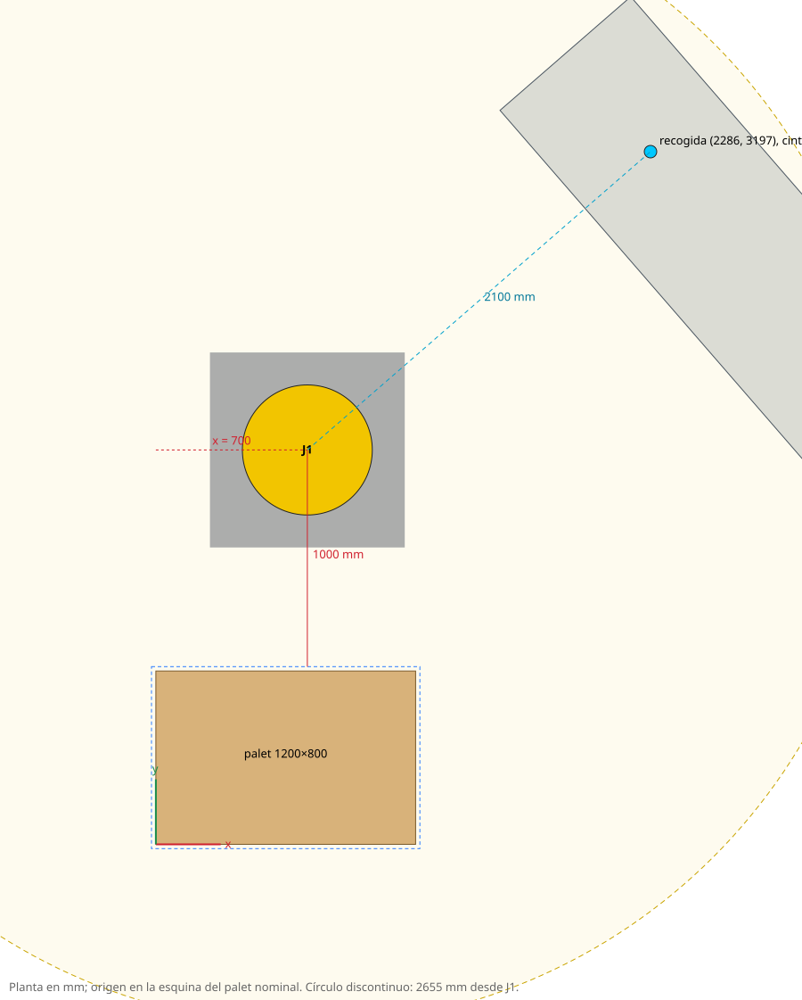

# Estudio de alcance · FANUC R-2000iC/165F con garra de 4 ventosas

Configuración `h6_sin_gate`, 10 seeds de referencia (1, 100, 12345, 314159, 42, 50021, 5678, 777, 9999, 99999), 1860 colocaciones en el orden real del algoritmo. Generado con `scripts/robot_reach_study.py` y `scripts/robot_study_report.py` (cinemática medida en el STEP del robot).

## Recomendación

- **Robot detrás del lado largo (y > 820)**: eje J1 en **x = 700, y = 1820 mm** (a 1000 mm del borde de la envolvente), mirando al centro del palet.
- **Pedestal de 900 mm** (J2 a 1570 mm del suelo; palet en el suelo).
- **Estación de recogida** a 2100 mm de J1, girada 135° respecto a la dirección del palet, en (2286, 3197); superficie de cinta a 1100 mm. Cajas con el largo L cruzado a la cinta, así la cara H×W de las de canto mira al robot.
- Resultado: **1787 / 1860 colocaciones viables (96.1 %)**; todas las recogidas en la cinta son alcanzables y las 4 ventosas (300 × 253 mm) caben en la cara de agarre de todas las cajas.

## Qué se comprueba en cada caja

Con las cajas ya colocadas de su palet (estado real del robot al colocarla):
1. **Entrada**: la garra con la caja colgando sube hasta librar todas las cajas del pasillo entre la caja y el robot (+50 mm).
2. **Bajada** vertical desplazada 20 mm hacia el lateral libre con más holgura (cenital si no hay ninguno) y **deslizamiento** a la posición final.
3. En cada pose (cada 150 mm de bajada): IK dentro de límites articulares y sin invadir ninguna caja colocada ni el palet con el robot (malla de los eslabones del STEP), la garra o la caja transportada.
4. Recogida: planas por la cara superior; de canto por la cara H×W en horizontal, levantar y reorientar (J5/J6) para dejarla con H×W arriba.

## Comparación de posiciones (mejor de cada lado)

| Lado | J1 a lo largo | Distancia | Pedestal | Viables |
|---|---:|---:|---:|---:|
| detrás del lado largo (y > 820) | 700 | 1000 | 900 | 1787 / 1860 (96.1 %) |
| en el lado corto derecho (x > 1220) | 1100 | 600 | 800 | 1602 / 1860 (86.1 %) |
| delante del lado largo (y < −20) | 600 | 800 | 800 | 1489 / 1860 (80.1 %) |
| en el lado corto izquierdo (x < −20) | 1000 | 600 | 800 | 1566 / 1860 (84.2 %) |

El algoritmo empieza a llenar por la esquina (−20, −20), lejos del lado N: con el robot detrás, las primeras columnas quedan al fondo y no estorban.

Sensibilidad alrededor del óptimo (la meseta es ancha: ±100 mm en x o distancia apenas cambia):

| Lado | x / y J1 | Distancia | Pedestal | Viables |
|---|---:|---:|---:|---:|
| N | 700 | 1000 | 900 | 1787 / 1860 |
| N | 650 | 1000 | 900 | 1785 / 1860 |
| N | 600 | 1000 | 900 | 1785 / 1860 |
| N | 650 | 950 | 900 | 1784 / 1860 |
| N | 700 | 950 | 900 | 1784 / 1860 |
| N | 600 | 950 | 900 | 1783 / 1860 |
| N | 600 | 900 | 800 | 1782 / 1860 |
| N | 600 | 850 | 800 | 1781 / 1860 |

## Las 73 colocaciones no viables

| Motivo | Cajas |
|---|---:|
| bajada: colisión de J3 | 27 |
| entrada sobre el pasillo: fuera de alcance / límite (fuera de alcance) | 14 |
| entrada sobre el pasillo: colisión de J3 | 8 |
| entrada sobre el pasillo: fuera de alcance / límite (limite J5) | 7 |
| aproximación lateral: colisión de J3 | 5 |
| posición final: colisión de J3 | 4 |
| bajada: colisión de J5 | 3 |
| posición final: colisión de J5 | 3 |
| entrada sobre el pasillo: colisión de J2 | 1 |
| bajada: colisión de J2 | 1 |

Las 1860 de 1860 posiciones finales se alcanzan (margen mínimo a los límites 15.9°): los fallos no son de alcance de la posición, sino de **la secuencia**: cajas bajas metidas en un hueco entre columnas altas (el antebrazo J3/la muñeca J5 tocan la columna al bajar) y cajas en la esquina lejana cuando ya hay pilas altas delante (no se puede pasar la caja por encima). El algoritmo no conoce el robot; usar este modelo como restricción de factibilidad al elegir hueco debería evitar la mayoría sin cambiar de robot (a cambio de algo de compactación, por medir).

## Cinta y lookahead K = 15

El algoritmo elige cualquiera de las 15 cajas visibles; en estas seeds la posición elegida en la cola se reparte casi uniforme (n.º 15 es la más frecuente). Con la estación propuesta el robot alcanza ±1300 mm a lo largo de la cinta. Con una cola fija y la primera caja en la estación, eso son las 4 primeras posiciones (ancho medio de caja a lo largo de la cinta 428 mm): **1536 de 1860 recogidas (83 %) quedarían fuera**. Hace falta que la cinta lleve la caja elegida a la estación (buffer/desviador), un séptimo eje o limitar K.

## Supuestos y límites

- Cinemática del STEP (a1=312, d1=670, a2=1075, a3=225, d4=1280, d6=215 mm), igual que el catálogo. Límites de catálogo: J1 ±185°, J2 −60/+76°, J3 −132/+180° (sobre la horizontal), J4 ±360°, J5 ±125°, J6 ±360°: **confirmar con el manual del modelo comprado**.
- Garra centrada en J6, cara de ventosas a 200 mm de la brida; 4 ventosas Ø90 a 210 × 163 mm; marco y columna modelados como cajas. Con la herramienta vertical J5 = 90° + J3: el antebrazo no puede subir más de 35°.
- Colisiones con nube de puntos de las mallas (40 mm) contra las cajas colocadas y el palet; el compensador se aproxima rígido. No se comprueban la cinta, el pedestal ni el trayecto entre poses fuera de los puntos muestreados, ni dinámica, cargas o tiempo de ciclo.
- El STEP es un modelo de terceros (CGTrader): sirve para el estudio, pero la geometría exacta debe confirmarse con el CAD oficial de FANUC antes de fijar el layout.
